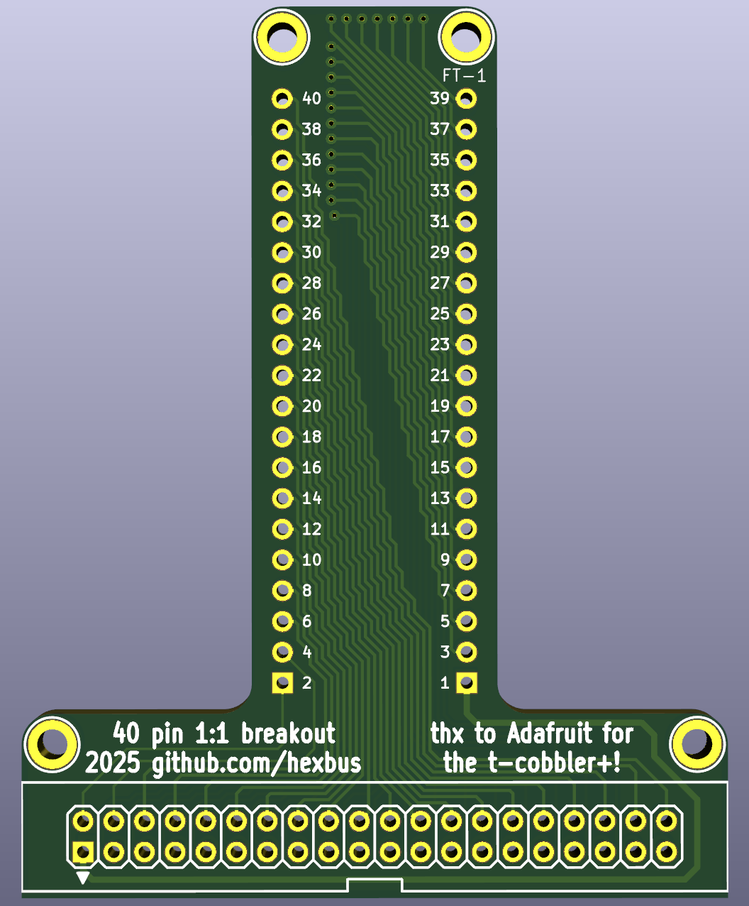

# 40pinbreakout
Universal 40-Pin Breadboard Breakout Board

## Overview

The **40pinbreakout** is a universal 40-pin breakout board designed for debugging, prototyping, and interfacing with systems that use standard 2x20 "IDE-style" headers.

Inspired (and the shape/traces derived by) the [Adafruit T-Cobbler](https://github.com/adafruit/Adafruit-Pi-Cobber-PCBs/), this board allows you to safely break out all 40 individual pins from a 2x20 header to a standard solderless breadboard or prototyping system.

Unlike many Raspberry Pi breakout boards, which often combine multiple grounds or omit certain pins, this breakout maintains a strict **1:1 pin mapping**, ensuring that every pin on the header is individually accessible. This is critical when working with vintage or retro computing hardware, where shared grounds or combined pins could potentially damage sensitive logic circuits.

## Applications

This breakout board is especially useful for retro computing projects that include 40-pin debug or expansion headers. Example projects include:

- The [C64 Cart64Out](https://github.com/svenpetersen1965/C64---Cart64out) project for Commodore 64 cartridge debugging.
- The [TI Compact Computer 40 Debug / Prototype Board](https://store.go4retro.com/ti-compact-computer-40-prototype-boards/) for the Texas Instruments CC-40.

Other vintage systems, embedded platforms, and development boards that expose a 40-pin header can also benefit from this breakout.

## Key Features

- Full 40-pin breakout (no combined or omitted pins)
- Standard 2x20 IDC (IDE-style) connector
- Compatible with common 40-pin ribbon cables
- Optimized for short cable runs to minimize bus capacitance and maintain signal integrity on vintage systems
- Ideal for safe debugging and prototyping without risking damage to host hardware

> **Note:** The shorter the ribbon cable, the better — especially when interfacing with legacy systems sensitive to signal degradation on longer bus runs.

## Board Image

